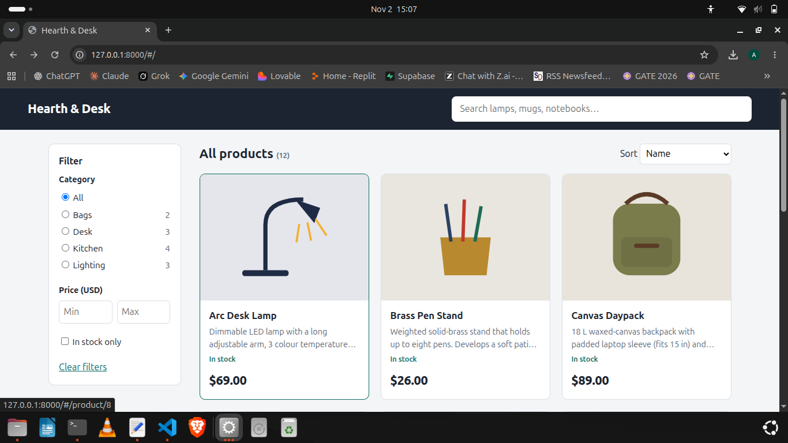
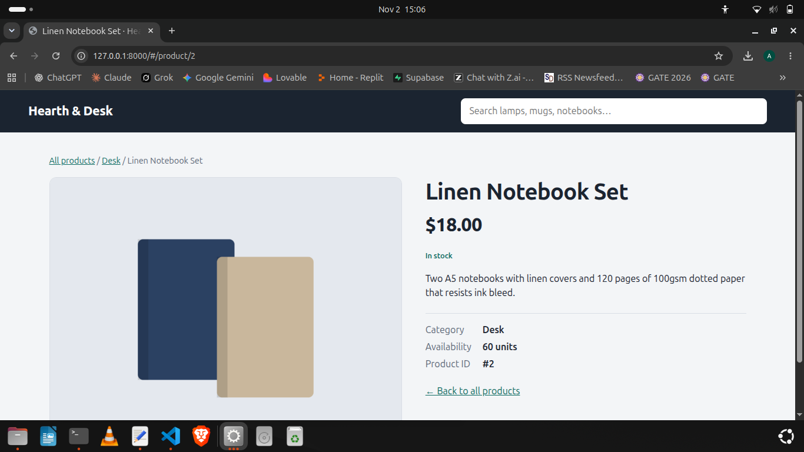

# Hearth & Desk — Product Listing Website (Part 1)

A small full-stack storefront: **vanilla JS frontend → FastAPI REST backend → SQLite relational database**.
The frontend never touches the database; every product it shows comes from `/api/*`.

| Listing | Details |
|---|---|
|  |  |

Search example: [docs/screenshots/search.png](docs/screenshots/search.png)

## Prerequisites
- Python 3.10+ (tested on 3.12) and `pip`
- A modern browser
- No separate database server needed (SQLite ships with Python)

## Run it (one computer, three commands)
```bash
python3 -m venv .venv && source .venv/bin/activate     # Windows: .venv\Scripts\activate
pip install -r requirements.txt
python db/init_db.py                                   # creates db/shop.sqlite3 and loads sample data
python -m uvicorn backend.main:app --port 8000         # start the app
```
Open **http://localhost:8000**. Interactive API docs: **http://localhost:8000/docs**.

To wipe and re-seed the database: `python db/init_db.py --reset`.

### Configuration
There is none required. Defaults: port `8000` (change with `--port`), database file `db/shop.sqlite3`.

## Project layout
```
backend/main.py       FastAPI app: REST endpoints + serves the frontend
db/schema.sql         Table definitions, constraints, indexes
db/seed.sql           Sample data (4 categories, 12 products)
db/init_db.py         Applies schema + seed to db/shop.sqlite3
frontend/             index.html, styles.css, app.js, images/ (SVG product art)
scripts/              make_images.py (regenerates SVGs), screenshots.py (README images)
docs/screenshots/     Listing, search and details screenshots
```

## Architecture
```
Browser (HTML/CSS/JS, hash-routed SPA)
   │  fetch JSON
   ▼
FastAPI  /api/*  — validates query/path params, builds parameterised SQL, returns JSON + status codes
   │  sqlite3
   ▼
SQLite  categories 1───* products
```
- One process serves both the API (`/api/...`) and the static frontend (`/`), so the app runs as a single unit.
- **Schema:** `categories(id, name, slug)` and `products(id, name, description, price_cents, image_url, category_id → categories.id, stock, created_at)`. Prices are stored as integer cents to avoid floating-point errors; `CHECK` constraints reject negative price/stock; indexes cover category, name and price.
- **Security basics:** all SQL is parameterised; sort order is chosen from a fixed allow-list; the frontend escapes all API text before rendering.
- **Frontend routing:** `#/` (listing with filters in the URL, e.g. `#/?q=lamp&category=desk`) and `#/product/<id>` (details), so views are bookmarkable.

## API
Base path `/api`. Responses are JSON.

| Method & path | Description |
|---|---|
| `GET /api/health` | Liveness check → `{"status":"ok"}` |
| `GET /api/categories` | All categories with `product_count` |
| `GET /api/products` | Paginated, filterable list (below) |
| `GET /api/products/{id}` | One product |

`GET /api/products` query parameters (all optional):

| Param | Type / rule | Meaning |
|---|---|---|
| `q` | string, ≤100 chars | Case-insensitive match on name or description |
| `category` | category slug | e.g. `desk`, `kitchen`, `lighting`, `bags` |
| `min_price`, `max_price` | number ≥ 0 (dollars) | Price range |
| `in_stock` | boolean | Only items with stock > 0 |
| `sort` | `name` (default), `price_asc`, `price_desc`, `newest` | Ordering |
| `page`, `page_size` | int ≥1; page_size 1–50 (default 12) | Pagination |

Example:
```
GET /api/products?category=desk&sort=price_desc&page_size=2
{ "items":[{"id":3,"name":"Brass Pen Stand","price":26.0,"price_cents":2600,
            "image_url":"/images/brass-pen-stand.svg",
            "category":{"id":1,"name":"Desk","slug":"desk"},"stock":18,"in_stock":true, ...}],
  "total":3,"page":1,"page_size":2,"total_pages":2 }
```

Status codes: `200` success · `400` logically invalid input (`min_price > max_price`) · `404` unknown product id · `422` malformed input (non-integer id, bad `sort`, `page_size` > 50, negative price) · `503` database not initialised.

Try it:
```bash
curl "localhost:8000/api/products?q=lamp"
curl -i localhost:8000/api/products/999      # 404
```
